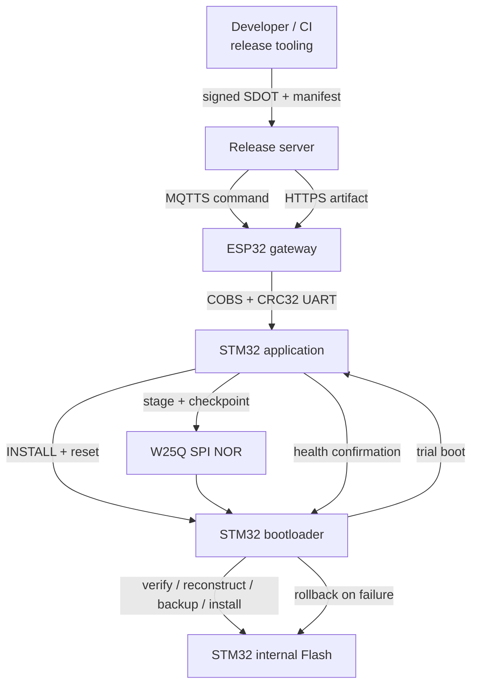

# Secure Delta OTA Bootloader

[](https://github.com/haikevins/secure-delta-ota-bootloader/actions/workflows/build.yml)
[](https://github.com/haikevins/secure-delta-ota-bootloader/actions/workflows/test.yml)
[](LICENSE)

A hardware-validated secure OTA system for **STM32F103C8T6**, using an **ESP32 gateway** for network delivery and external **SPI NOR flash** for resumable staging, reconstruction, backup, and recovery.

The project supports authenticated **full and delta firmware updates**, exact-base validation, reset-safe installation, trial boot, and automatic rollback. Firmware authenticity is enforced on the STM32 bootloader with **ECDSA P-256** and SHA-256; transport uses **MQTTS**, **HTTPS**, and a framed UART protocol between the ESP32 and STM32.

> **Status:** Integrated firmware, host tooling, release tooling, and physical fault-injection workflow are implemented. The checked-in hardware evidence records **9/9 PASS**. The repository intentionally ships with an **unprovisioned trust anchor**; production signing keys are not included.

## Why this project

Secure firmware update is not only a download problem. A practical OTA design also has to answer:

- How does the device authenticate a candidate image before installation?
- How can a delta update prove it was generated from the exact active base image?
- What happens if power is lost during download, reconstruction, backup, install, or trial boot?
- How is a known-good image recovered when the new firmware never confirms healthy operation?
- Which component owns networking, staging, installation authority, and signing trust?

This repository implements those concerns as one end-to-end system instead of isolated bootloader examples.

## Key capabilities

| Area | Implemented behavior |
|---|---|
| Firmware authenticity | ECDSA P-256 signature verification on STM32 with SHA-256 image binding |
| Delta OTA | JojoDiff-based exact-base delta reconstruction with signed full-image fallback |
| Anti-downgrade | Product, hardware revision, version, and base-image policy checks |
| Resumable transfer | Persistent receive checkpoints for UART staging into W25Q SPI NOR |
| Reset-safe installation | Persistent reconstruction, backup, install, and verification progress |
| Recovery | Verified active-image backup and automatic rollback after failed trial boots |
| Gateway | ESP32 MQTTS command/status path, HTTPS artifact download, persistent cache, UART OTA |
| Release tooling | Signed SDOT artifacts, immutable release directory, manifest verification |
| Verification | Host checks, warning-clean firmware builds, benchmark automation, deterministic HIL fault matrix |

## System architecture



The trust boundary is deliberate: the ESP32 owns network transport and orchestration, but the **STM32 bootloader remains the final installation authority**. CRC32 detects accidental corruption; ECDSA P-256 provides firmware authenticity.

Detailed design: [Architecture](docs/architecture.md) · [Threat Model](docs/threat-model.md) · [Boot State Machine](docs/boot-state-machine.md)

## Verified results

The checked-in benchmark reference is stored in [`benchmarks/reference.json`](benchmarks/reference.json). Binary size depends on the compiler/toolchain, so the repository treats the benchmark as reproducible evidence rather than a permanent size promise.

| Metric | Checked-in reference |
|---|---:|
| Bootloader Flash | `11,400 B / 24,576 B` (`46.39%`) |
| Application v2 Flash | `11,276 B / 38,912 B` (`28.98%`) |
| Raw delta | `970 B` |
| Raw delta savings | `91.40%` |
| Signed delta | `1,174 B` |
| Signed full | `11,480 B` |
| Signed delta savings | `89.77%` |
| Physical HIL fault matrix | **9/9 PASS** |

The HIL matrix covers reset/power-loss behavior across receive, patch, backup, install, verification, trial boot, rollback, and gateway/release paths. See [Hardware-in-the-Loop Results](docs/hil-results.md) and [Validation Report](VALIDATION.md).

## Quick start

### Requirements

For the STM32 build and validation flow:

- GNU Arm Embedded toolchain (`arm-none-eabi-gcc`, `arm-none-eabi-objcopy`, `arm-none-eabi-size`), or a complete Clang/LLD fallback toolchain;
- Python 3;
- OpenSSL;
- GNU Make.

For ESP32 firmware, use an ESP-IDF environment. Hardware workflows additionally require OpenOCD and connected STM32/ESP32 targets.

### Run the integrated project gate

```bash
make check TOOLCHAIN=gcc
```

Run the warning-clean firmware gate:

```bash
make warning-check TOOLCHAIN=gcc
```

Generate a current benchmark:

```bash
make benchmark TOOLCHAIN=gcc
```

Build the STM32 firmware images:

```bash
make firmware TOOLCHAIN=gcc
make combined TOOLCHAIN=gcc
```

Build the ESP32 gateway:

```bash
source ~/esp/esp-idf/export.sh
make gateway
```

All root Make targets and their side effects are documented in [Make Command Reference](docs/make-command-reference.md).

## Signed release workflow

Create a signed full/delta release from a target application image and, optionally, its previous base image:

```bash
make release \
  TARGET=/path/to/application-v2.bin \
  TARGET_VERSION=2 \
  BASE=/path/to/application-v1.bin \
  BASE_VERSION=1 \
  SIGNING_KEY=/secure/path/firmware-signing.pem \
  KEY_ID=0x15000001 \
  BASE_URL=https://firmware.example
```

The private signing key must live **outside this repository**. The release tooling rejects an in-repository private key and applies restrictive key-permission checks on POSIX hosts.

See [Release Process](docs/release-process.md) and [Firmware Container](docs/firmware-container.md).

## Hardware validation

Run the deterministic hardware fault matrix after exporting the ESP-IDF environment and configuring the connected targets:

```bash
source ~/esp/esp-idf/export.sh
export STM32_OPENOCD=/usr/bin/openocd
export STM32_OPENOCD_SCRIPTS=/usr/share/openocd/scripts

make hil-test \
  TOOLCHAIN=gcc \
  ESP32_PORT=/dev/ttyUSB0 \
  WIFI_SSID="your-ssid" \
  WIFI_PASSWORD="your-password" \
  SDOTA_HOST_IP=<PC_LAN_IP>
```

For a short portfolio walkthrough, see the [5-Minute Demo Guide](docs/portfolio-demo.md).

## Repository map

```text
node-stm32f103/
├── bootloader/          final firmware trust, install and recovery authority
├── application/         UART receiver, staging and trial confirmation
├── common/              W25Q driver and persistent storage abstractions
├── cmsis/               Cortex-M3 support
└── spl/                 STM32F1 Standard Peripheral Library

gateway-esp32/           ESP-IDF MQTTS + HTTPS + cache + UART OTA
shared/                   shared protocol, container and metadata primitives
server/                   release verification, HTTPS serving and MQTT publication
tools/                    signing, SDOT, delta, release and inspection tools
scripts/                  validation, benchmark, flashing and HIL automation
tests/                    host, unit, protocol and fault-test assets
benchmarks/               checked-in reference measurements
docs/                     architecture, protocol, recovery and evidence docs
```

## Documentation

Start with these documents depending on what you want to inspect:

| Goal | Document |
|---|---|
| Understand the whole system | [Architecture](docs/architecture.md) |
| Review Flash/SPI NOR layout | [Memory Map](docs/memory-map.md) |
| Inspect ESP32 ↔ STM32 transport | [UART OTA Protocol](docs/uart-ota-protocol.md) |
| Understand signed artifacts | [Firmware Container](docs/firmware-container.md) |
| Review reset recovery | [Boot State Machine](docs/boot-state-machine.md) |
| Review security assumptions | [Threat Model](docs/threat-model.md) |
| Reproduce release creation | [Release Process](docs/release-process.md) |
| Review source release history | [Changelog](CHANGELOG.md) |
| Review the stable project baseline | [v1.0.0 Release Notes](docs/project-release-v1.0.0.md) |
| Review test coverage | [Test Plan](docs/test-plan.md) |
| Inspect physical test evidence | [HIL Results](docs/hil-results.md) |
| Reproduce measurements | [Benchmark Guide](docs/benchmark-portfolio.md) |
| See claim-to-evidence mapping | [Portfolio Evidence](docs/portfolio-evidence.md) |

Full documentation index: [`docs/README.md`](docs/README.md)

Comprehensive engineering report: [`REPORT.md`](REPORT.md)

Validation/evidence summary: [`VALIDATION.md`](VALIDATION.md)

## Security boundaries

The project implements signed firmware, anti-downgrade checks, exact-base delta verification, redundant metadata, verified backup, resumable operations, trial confirmation, and rollback.

It does **not** claim protection against invasive physical attacks, a compromised signing environment, denial of service, firmware confidentiality, secure-element key storage, bootloader self-update, irreversible production debug locking, or fleet-scale scheduling.

Those are explicit scope boundaries rather than hidden assumptions. See the [Threat Model](docs/threat-model.md) for the full analysis.

## Contributing and security reports

Build/test expectations and repository workflow are documented in [`CONTRIBUTING.md`](CONTRIBUTING.md). Security reporting guidance and supported scope are documented in [`SECURITY.md`](SECURITY.md).

## License

Released under the [MIT License](LICENSE).
