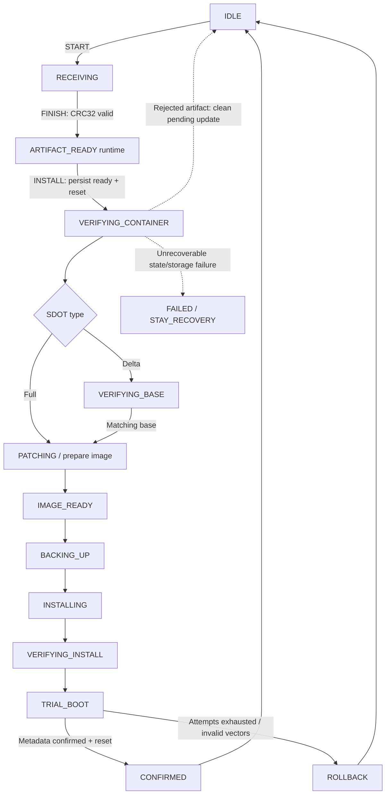
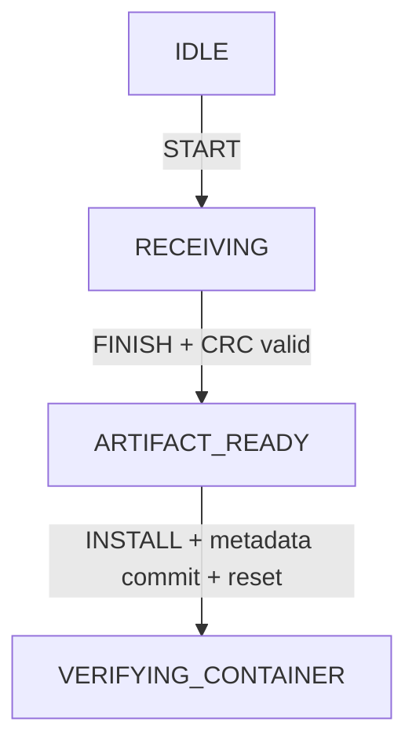
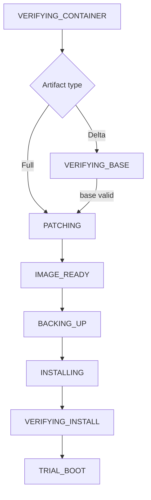
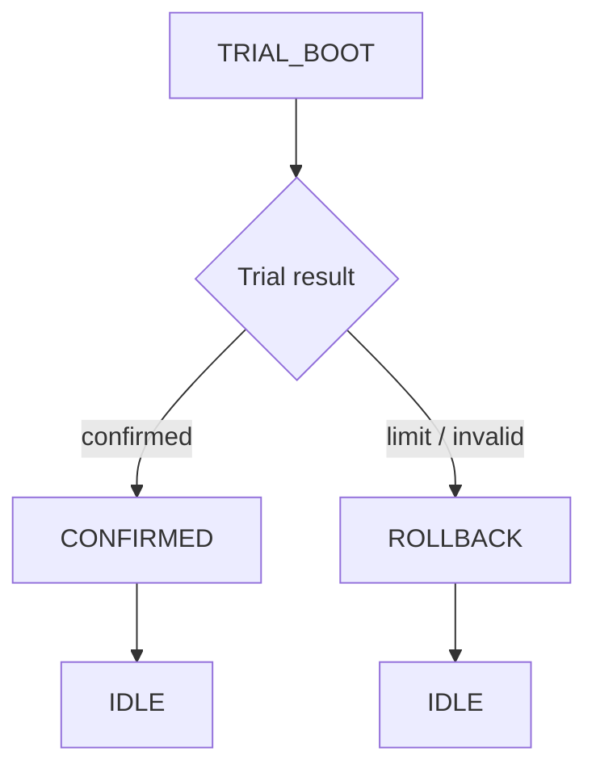

# Boot and Update State Machine

[↑ Documentation Index](README.md) · [← Root](../README.md) · [← Firmware Container](firmware-container.md) · [Metadata / Boot Decision →](metadata-and-boot-decision.md)

> **Status:** **Implemented: signed full/delta install, persistent recovery, trial boot and rollback**

## Table of contents

- [1. Update states](#1-update-states)
- [2. High-level transition diagram](#2-high-level-transition-diagram)
- [Implemented trial boot and rollback path](#implemented-trial-boot-and-rollback-path)
- [3. Boot decision order](#3-boot-decision-order)
- [4. Metadata design](#4-metadata-design)
- [5. Application validity](#5-application-validity)
- [6. Trial boot policy](#6-trial-boot-policy)
- [7. Power-loss guarantees](#7-power-loss-guarantees)
- [8. Illegal transitions](#8-illegal-transitions)
## 1. Update states

```c
typedef enum
{
    UPDATE_IDLE = 0,

    UPDATE_RECEIVING,
    UPDATE_ARTIFACT_READY,

    UPDATE_VERIFYING_CONTAINER,
    UPDATE_VERIFYING_BASE,
    UPDATE_PATCHING,
    UPDATE_IMAGE_READY,

    UPDATE_BACKING_UP,
    UPDATE_INSTALLING,
    UPDATE_VERIFYING_INSTALL,

    UPDATE_TRIAL_BOOT,
    UPDATE_CONFIRMED,

    UPDATE_ROLLBACK,
    UPDATE_FAILED
} UpdateState_t;
```

## 2. High-level transition diagram



For signed SDOT, both full and delta artifacts enter **persisted
`UPDATE_PATCHING`**: full-image preparation copies the payload into the
reconstructed partition; delta preparation validates the base image and applies
the patch. `UPDATE_FAILED` maps to `BOOT_ACTION_STAY_RECOVERY`; the current
bootloader does not run an application UART `START` handler in that state.
Validated source rejection can instead clear the pending update and return to
`UPDATE_IDLE` without overwriting the active application.


### Focused persisted-state flows

The persisted boot process consists of artifact acceptance, candidate preparation, and trial closure. `ARTIFACT_READY` first exists in the **application receiver session** on successful FINISH; `INSTALL` persists it in internal boot metadata before reset.

**Artifact acceptance**



`DATA` and resume operations remain in `RECEIVING`; they update the persisted receive checkpoint rather than creating another boot state.

**Candidate preparation and installation**



**Trial closure**



## Implemented trial boot and rollback path

```text
RECEIVING -> ARTIFACT_READY
                 |
              INSTALL
                 |
              reset
                 v
     [verify signed container]
                 |
        [prepare target image]
                 |
            BACKING_UP
                 |
            INSTALLING
                 |
        VERIFYING_INSTALL
                 |
            TRIAL_BOOT
            /       \
      CONFIRMED    attempt limit /
          |        invalid trial
          v           |
         IDLE      ROLLBACK
                     |
                     v
                    IDLE
```

`active_version` is not promoted when installation finishes. It remains the
last confirmed version until the trial application commits `CONFIRMED`.

Backup progress is committed at 4 KiB W25Q sector boundaries. Install and
rollback progress are committed at 1 KiB internal Flash page boundaries.
Before each trial jump, `boot_attempts` is persisted and IWDG is started.
Maximum unconfirmed attempts remain three.

## 3. Boot decision order

On reset, the bootloader performs:

1. initialize clock minimally, watchdog policy, debug and storage;
2. load and validate internal boot metadata A/B, select newest valid generation (or defaults);
3. validate the active application's vectors;
4. evaluate state + vector validity using `BootDecision_Evaluate()`;
5. dispatch secure-container, installation, trial-confirmation or rollback work as needed and reevaluate committed state;
6. jump only when the resulting decision permits a valid application.

Decision table:

| Persisted state | Bootloader action |
|---|---|
| IDLE | Validate active application; jump or stay in recovery |
| RECEIVING | Do not install; jump active application so transfer can resume |
| ARTIFACT_READY | Process signed artifact (`BOOT_ACTION_PROCESS_ARTIFACT`) |
| VERIFYING_CONTAINER | Restart validation from beginning |
| VERIFYING_BASE | Restart base verification |
| PATCHING | Erase reconstructed partition and restart patch safely |
| IMAGE_READY | Continue with backup |
| BACKING_UP | Restart or resume backup using verified progress metadata |
| INSTALLING | Resume installation from last verified internal page |
| VERIFYING_INSTALL | Re-run complete installed-image verification |
| TRIAL_BOOT | Increment attempt policy and boot target, or rollback when limit reached |
| CONFIRMED | Commit new active version, retire backup per policy, transition IDLE |
| ROLLBACK | Resume restore from backup |
| FAILED | `BOOT_ACTION_STAY_RECOVERY`; current boot path remains in fatal LED loop rather than jumping Application or accepting UART START |

## 4. Metadata design

```c
typedef struct
{
    uint32_t magic;
    uint32_t generation;
    uint32_t metadata_version;

    uint32_t state;
    uint32_t active_version;
    uint32_t pending_version;

    uint32_t active_update_id;
    uint32_t received_size;
    uint32_t expected_size;

    uint32_t copy_offset;
    uint32_t boot_attempts;
    uint32_t last_error;

    uint32_t crc32;
} BootMetadata_t;
```

Internal Flash contains complete Metadata A and B records in separate 1 KiB erase pages at `0x0800F800` and `0x0800FC00`. A new record is written to the older/invalid page, read back, CRC-validated and byte-compared. The currently selected page is not erased until a newer verified copy exists. External Metadata A/B contains the 36-byte CRC-protected
application-to-bootloader install handoff at offset `0x000` and, from power-loss recovery,
a 40-byte CRC-protected persistent download checkpoint at offset `0x100`.
The external records are used for download checkpoints and optional legacy install handoff; signed-SDOT `INSTALL` persists its request in **internal** metadata A/B. The storage layers preserve the other record type across the 4 KiB sector erase.

## 5. Application validity

Before jump, bootloader checks at minimum:

- initial MSP lies inside `0x20000000`–`0x20005000` (top-of-stack inclusive) and is 8-byte aligned;
- reset handler lies inside the application Flash region and has Thumb bit set;
- application size from trusted metadata is nonzero and within bounds;
- installed image hash matches trusted metadata when state requires it.

Jump sequence:

```text
disable interrupts
stop SysTick
reset/disable used peripherals
clear NVIC enable and pending state
set SCB->VTOR = APPLICATION_START_ADDRESS
load MSP from application vector table
branch to application reset handler
```

## 6. Trial boot policy

Initial policy:

- maximum unconfirmed boot attempts: 3;
- backup remains available throughout trial;
- the current application calls `TrialConfirmation_Init()` and periodically
  `TrialConfirmation_Process(now_ms)`; after the default 750 ms of initialized
  main-loop liveness, `TrialConfirmation_ConfirmNow()` commits
  `UPDATE_CONFIRMED` and `NVIC_SystemReset()` returns to the bootloader;
- the optional UART `CONFIRM` command invokes the same metadata confirmation
  function before ACK/reset;
- a watchdog reset before confirmation consumes a trial attempt (attempt is
  committed before the trial jump);
- after the attempt limit, state transitions to ROLLBACK.

**Scope of the implemented health criterion:** reaching the automatic
confirmation proves the current application's clock/SysTick setup, GPIO
initialization, UART/OTA agent initialization and main loop are running. It is
not a comprehensive peripheral or product-level self-test; a production
integration can strengthen this gate without changing the confirmation record
format.

## 7. Power-loss guarantees

### During download

Active internal application is untouched. A redundant external checkpoint is
committed at each complete 4 KiB receive boundary. After reset, the application
restores the newest valid checkpoint, re-erases the first uncheckpointed
Incoming sector, and the PC resumes from that conservative offset.

### During patching

The existing active application is untouched. With a valid signed SDOT
artifact, `SecureContainer_Process()` restarts image preparation from the
persisted `UPDATE_PATCHING` state: it erases the reconstructed partition and
replays the full-copy or delta-reconstruction operation, then verifies the
target hash. The HIL `patch-reset` scenario exercises this restart behavior.

### During backup

Internal application remains untouched. Installation cannot start until backup verification succeeds.

### During installation

Progress is committed after each verified internal Flash page. Reset resumes installation from the first unverified page. If source reconstructed image becomes invalid, rollback is attempted from verified backup.

### During rollback

Restore progress is also page-based and idempotent.

## 8. Illegal transitions

Examples that must be rejected:

- DATA while not RECEIVING;
- INSTALL while RECEIVING;
- PATCHING before signature and base checks;
- INSTALLING before backup verification;
- CONFIRMED without TRIAL_BOOT;
- clearing backup before confirmation;
- accepting a different update ID during RECEIVING without ABORT or new START cleanup.

## References

- [`boot_metadata.h`](../shared/include/boot_metadata.h)
- [`boot_decision.c`](../node-stm32f103/bootloader/src/boot_decision.c)
- [`boot_manager.c`](../node-stm32f103/bootloader/src/boot_manager.c)

[↑ Documentation Index](README.md) · [← Root](../README.md) · [← Firmware Container](firmware-container.md) · [Metadata / Boot Decision →](metadata-and-boot-decision.md)
